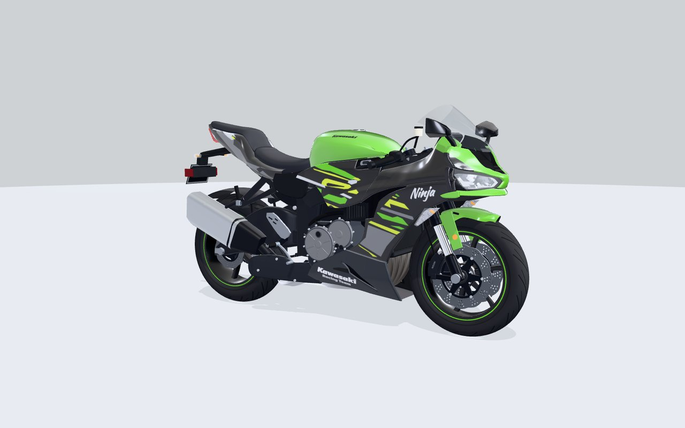
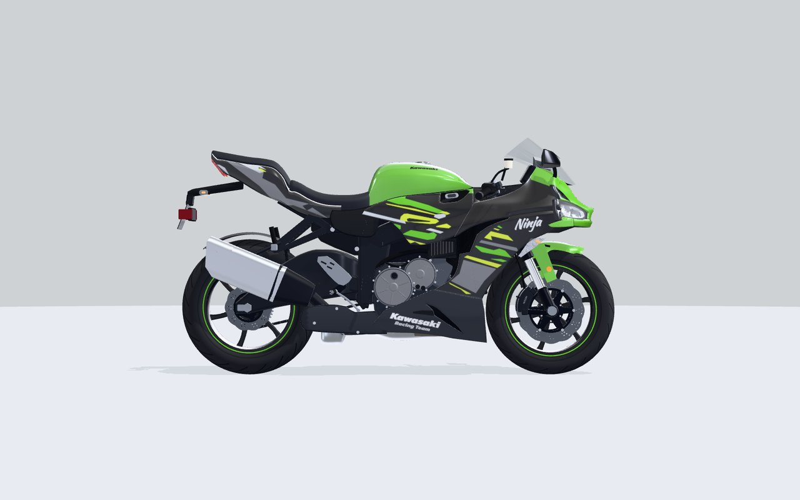
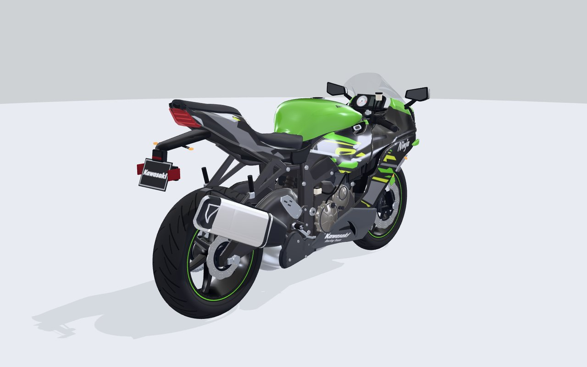
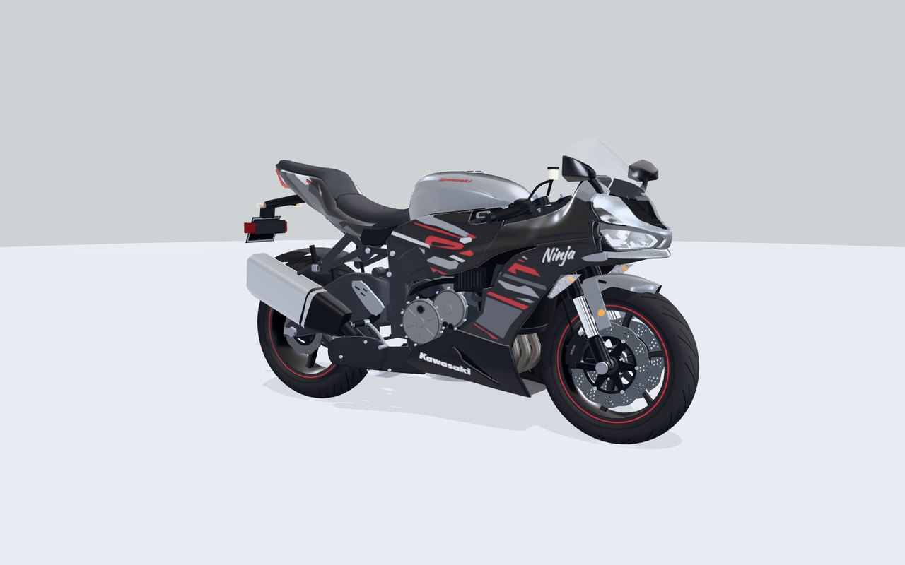
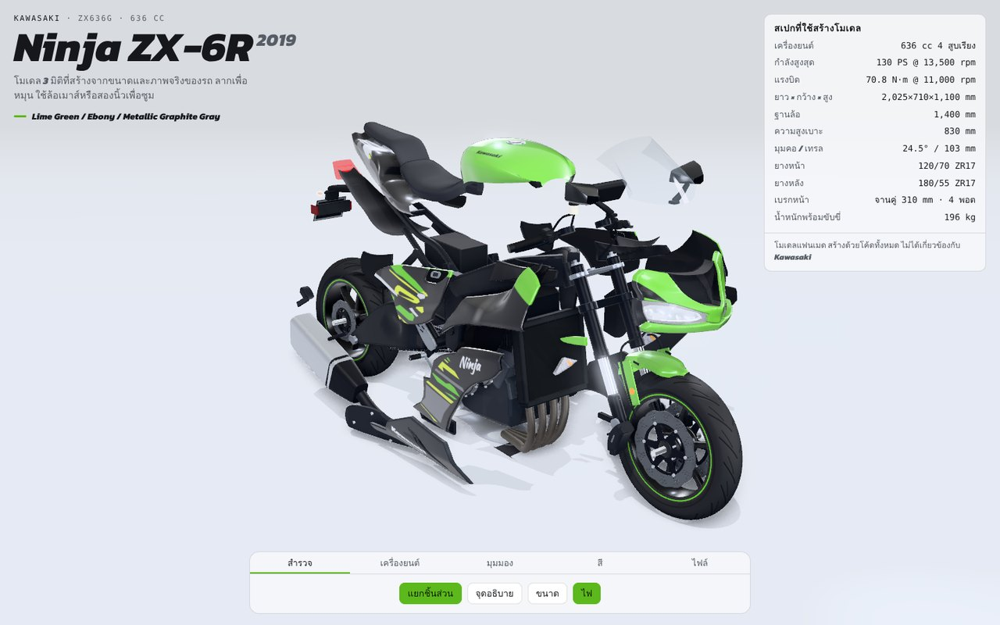
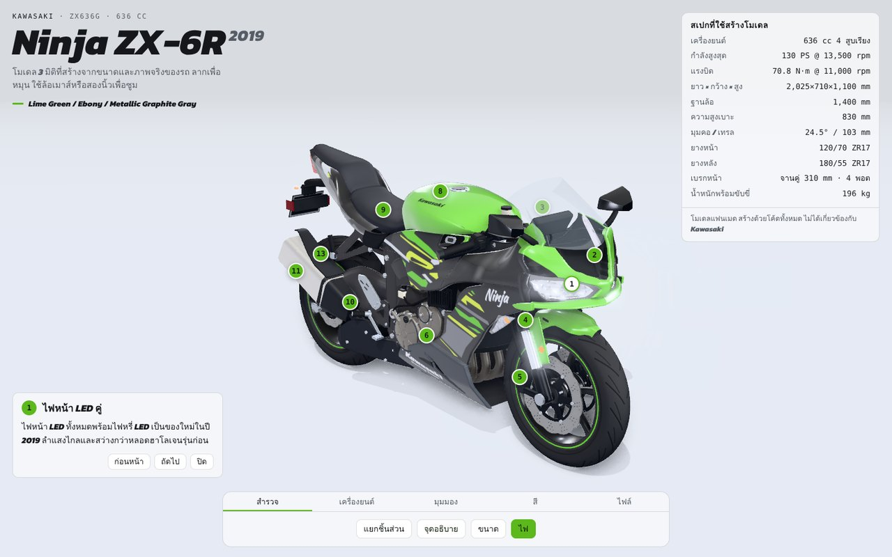
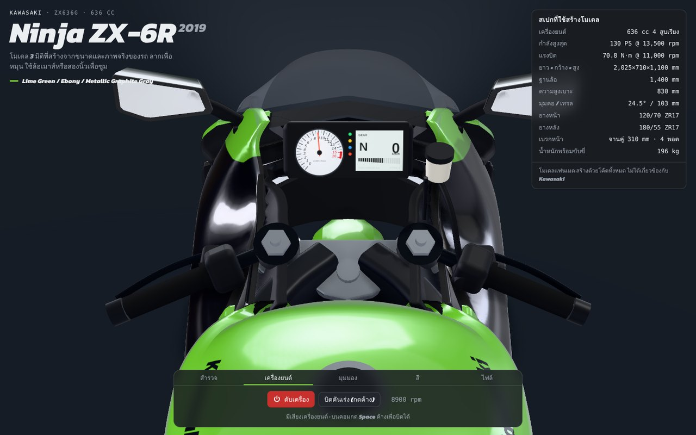

# Kawasaki Ninja ZX-6R 2019 — โมเดล 3 มิติ

**ดูออนไลน์: https://chitipat-web.github.io/3D/**

โมเดล 3 มิติของ **Kawasaki Ninja ZX-6R ปี 2019 (ZX636G)** สร้างด้วยโค้ด three.js ทั้งคัน
ไม่ได้ใช้ไฟล์โมเดลจากภายนอก (ไฟล์ภายนอกมีแค่ภาพแสงสตูดิโอ HDRI แบบ CC0 และฟอนต์ตัวอักษรบนลายรถแบบ OFL) สัดส่วนอิงจากสเปกจริง และรูปทรงแฟริ่งลอกจากภาพถ่ายด้านข้างของรถจริง
ที่ปรับสเกลด้วยฐานล้อ 1,400 mm



| ด้านข้าง | ด้านหลัง ¾ | สี Pearl Storm Gray |
| --- | --- | --- |
|  |  |  |

## หน้าดูโมเดล (`index.html`)

| แยกชิ้นส่วน | จุดอธิบายชิ้นส่วน | มุมคนขี่ + สตาร์ทเครื่อง |
| --- | --- | --- |
|  |  |  |

- **สำรวจ**: แยกชิ้นส่วนแบบเคลื่อนไหว, จุดอธิบาย 13 จุดเป็นภาษาไทย, เส้นบอกขนาด, เปิด/ปิดไฟ, ตารางสเปก
- **เครื่องยนต์**: สตาร์ทเครื่องพร้อมเสียงเครื่อง 4 สูบที่สังเคราะห์ในเบราว์เซอร์ กดค้างเพื่อบิดคันเร่ง (บนคอมกด Space ค้างได้)
  เข็มวัดรอบและจอ LCD บนหน้าปัดขยับตามรอบจริง
- **มุมมอง**: หน้า ¾, ข้าง, หลัง ¾, หน้า, บน, มุมคนขี่ และหมุนอัตโนมัติ
- **สี**: KRT Edition และ Pearl Storm Gray
- **ไฟล์**: บันทึกภาพ PNG และดาวน์โหลดโมเดล GLB
- แสงและเงาสะท้อนมาจากภาพสตูดิโอถ่ายจริง (HDRI) หมุนให้ไฟสตูดิโออยู่ด้านบนหลังรถ และเพิ่มไฟเพดานนุ่มเหนือรถแบบสตูดิโอถ่ายรูปโฆษณา
  แผงสีดำจึงเห็นรูปทรงและเงาไล่ระดับ ไม่ดำทึบหรือเป็นแสงขาวจ้า มีเงาในซอกด้วย ambient occlusion
  และไฟ LED มีแสงฟุ้ง (bloom) ถ้าเครื่องช้าจะลดคุณภาพลงเอง

## เปิดนอกเว็บ

| ใช้กับ | วิธีเปิด |
| --- | --- |
| คอม (Windows / Mac / Linux) | ดาวน์โหลด [`offline/kawasaki-zx6r-2019.html`](offline/kawasaki-zx6r-2019.html) แล้วดับเบิลคลิก เปิดใน Chrome, Edge, Safari หรือ Firefox ได้ทันที ไม่ต้องต่อเน็ต ไม่ต้องล็อกอิน ส่งต่อให้คนอื่นทาง LINE หรืออีเมลได้ |
| Android | ดาวน์โหลดไฟล์ HTML เดียวกัน แล้วเลือกเปิดด้วย Chrome |
| iPhone / iPad | ดาวน์โหลด [`models/kawasaki-zx6r-2019.usdz`](models/kawasaki-zx6r-2019.usdz) แล้วแตะเปิดจากแอป Files จะหมุนดูแบบ 3 มิติได้ และกด AR เพื่อวางรถขนาดจริงในห้อง |
| Blender และโปรแกรม 3D อื่น | เปิด `models/kawasaki-zx6r-2019.glb` (File → Import → glTF 2.0) |
| ลิงก์ที่ใครก็เปิดได้ | **https://chitipat-web.github.io/3D/** เปิดได้ทุกเครื่องโดยไม่ต้องล็อกอิน บนมือถือมีปุ่ม "ดูขนาดจริงใน AR" (iPhone ใช้ AR Quick Look, Android ใช้ Scene Viewer) |

## ไฟล์ที่ใช้งานได้ทันที

| ไฟล์ | ใช้ทำอะไร |
| --- | --- |
| `models/kawasaki-zx6r-2019.glb` | โมเดลสี KRT Edition (Lime Green / Ebony / Graphite Gray) เปิดได้ใน Blender, Windows 3D Viewer, https://gltf-viewer.donmccurdy.com ฯลฯ |
| `models/kawasaki-zx6r-2019-gray.glb` | โมเดลสี Pearl Storm Gray / Metallic Spark Black |
| `models/kawasaki-zx6r-2019.usdz` | โมเดลสี KRT สำหรับ iPhone/iPad (AR Quick Look) ขนาดจริง |
| `offline/kawasaki-zx6r-2019.html` | หน้าดูโมเดลแบบไฟล์เดียว เปิดจากเครื่องได้โดยไม่ต้องต่อเน็ต |
| `index.html` | หน้าเว็บดูโมเดล (รายละเอียดด้านบน) |

ไฟล์ GLB ใช้หน่วยเมตร ขนาดจริง (แกน +X ไปทางหน้ารถ, +Y ขึ้นบน) ประมาณ 276,000 สามเหลี่ยม แยกชิ้นส่วนตามชื่อ
เช่น `Nose`, `UpperSideCowl`, `Tank`, `TailCowl`, `FrontWheel`, `FrontFork`, `Engine`, `Exhaust` เพื่อให้แก้ไขต่อได้ง่าย

## เปิดหน้าดูโมเดลในเครื่อง

```bash
npm install          # ติดตั้ง three.js และเครื่องมือ (หน้าเว็บโหลด three.js จาก CDN เอง)
npm run serve        # แล้วเปิด http://localhost:8080
```

## สเปกที่ใช้สร้างโมเดล

| รายการ | ค่า |
| --- | --- |
| เครื่องยนต์ | 636 cc 4 สูบเรียง DOHC 16 วาล์ว |
| กำลังสูงสุด | 130 PS @ 13,500 rpm (136 PS เมื่อมี ram air) |
| แรงบิดสูงสุด | 70.8 N·m @ 11,000 rpm |
| น้ำหนักพร้อมขับขี่ | 196 kg |
| ยาว × กว้าง × สูง | 2,025 × 710 × 1,100 mm |
| ฐานล้อ | 1,400 mm |
| ความสูงเบาะ | 830 mm |
| มุมคอ / เทรล | 24.5° / 103 mm |
| ยาง | หน้า 120/70 ZR17, หลัง 180/55 ZR17 |
| เบรก | หน้า จานคู่ 310 mm คาลิปเปอร์ Nissin 4 พอต, หลัง จาน 220 mm |
| ช่วงล่าง | หน้า Showa SFF-BP 41 mm หัวกลับ, หลัง Bottom-link Uni-Trak |

ขนาดกล่องครอบของโมเดลที่ได้: 2,031 × 719 × 1,105 mm (ต่างจากสเปกไม่เกิน 2%)

## รายละเอียดที่สร้างไว้

- **ด้านหน้า**: หน้ากากปี 2019 ทรงลิ่มเมื่อมองจากด้านบน (ปาดไปด้านหลังราว 30° จากปลายจมูก วัดจากเงารถในภาพมุม 3/4)
  แขนสีเขียวรูปตัว V แคบที่ปลายจมูกแล้วบานออกเป็นแผงกว้างรอบขากระจก มีสันคมตามแนวแขน
  คร่อมช่อง ram air สีดำที่ลงมาใกล้ไฟหน้า สีเขียวของหน้ากากต่อไปตามขอบชิลด์ด้านข้าง,
  ไฟหน้า LED ทรงใบมีดปลายแหลมชี้ไปที่จมูก 2 ดวง ปลายด้านนอกตัดเฉียงจากมุมบนด้านหลังลงมาข้างหน้า และขอบล่างวางชิดคาง
  (วัดจากภาพด้านข้างทั้งสองฝั่งแล้วฉายลงบนผิวหน้ากาก ตรวจกับภาพหน้ารถระยะใกล้) ข้างในเป็นกรอบดำ คิ้วดำคลุมครึ่งนอก
  รีเฟลกเตอร์โครเมียมแบบเหลี่ยมเพชร (แต่ละเหลี่ยมเอียงต่างกันจึงระยิบระยับแบบเจียระไน) และแถบ LED ไฟหรี่ที่ขอบล่าง,
  คางแหลมขอบคมอยู่ต่ำ ด้านบนเป็นแผ่นกว้างลาดขึ้นไปหาไฟหน้า, ชิลด์ใสสีควันทรงโค้งรัดรอบเรือนไมล์ (มุมบนเฉียงไปด้านหลังตามภาพจริง),
  กระจกมองข้างทรงลิ่มบนขาที่อยู่ค่อนไปด้านหลังและชิดกลางตามภาพจริง
  (ทรงจมูกด้านข้างวัดจากภาพจริงคลาดไม่เกิน 1 ซม.)
- **บังโคลนหน้า**: ทรงสั้นเหลี่ยม ปลายหน้าแหลมเชิดขึ้น มีช่องระบายด้านข้าง และขาบังโคลนสีเขียวกว้างลงมาหน้ากระบอกโช้ค
  พร้อมทับทิมสะท้อนแสงสีส้มตามภาพจริง
- **แฟริ่ง**: แผงข้างแยกเป็นชิ้นจริง 5 ชิ้นต่อข้าง (ชิ้นบน, แผงข้างหลักชิ้นเดียวตั้งแต่ใต้ไฟหน้าลงถึงอันเดอร์คาวล์ที่มีคำว่า "Ninja" และแถบลาย,
  ฝาข้างใต้ถัง, ฝาข้างใต้เบาะสีดำด้าน, อันเดอร์คาวล์) ขอบม้วนเข้า ขอบล่างของชิ้นบนซ้อนทับแผงหลักเป็นรอยต่อเหนือคำว่า "Ninja"
  ขอบหลังของแผงหลักเฉียงลงเป็นปากช่องระบายลมร้อนหม้อน้ำ (ด้านในลึกและดำ มีครีบ) จุดที่สองชิ้นมาบรรจบเป็นครีบแหลม
  และมีสันพับเป็นแถบเอียงรับแสงต่อจากครีบยาวไปจนใต้ถัง ตำแหน่งเส้นเหล่านี้วัดจากภาพรถจริง 3 ภาพ (รถสีดำ, KRT ด้านข้าง, KRT มุม 3/4)
  ที่ฉายลงบนโมเดลด้วยตำแหน่งกล้องที่คำนวณจากภาพ ด้านในของแฟริ่งเป็นพลาสติกดำไม่ทำสี
  ฝาข้างใต้ถังทรงเรียวตามรูปจริงพร้อมเส้นสีเงินที่ขอบล่าง จึงเห็นเฟรมด้านล่าง แถบเขียวไล่ขึ้นตามขอบชิลด์ และไฟเลี้ยวหน้าเลนส์ใสทรงเรียว,
  ระหว่างขอบบนของชิ้นบนกับคอรถมีแผงในลาดหงายรับแสง และใต้หน้าถังมีช่องเว้าสีดำพร้อมจุกวงรีตามภาพจริง,
  อันเดอร์คาวล์วัดใหม่จากภาพด้านข้างทั้งสองฝั่ง: ขอบหน้าตั้งเกือบตรงลงต่ำถึงระดับ 15 ซม. มีช่องลมรูปลิ่มสีดำ
  และสองข้างไม่เหมือนกัน (ฝั่งขวายาวไปถึงรอยบากหน้าแผงกันความร้อน ฝั่งซ้ายสั้นกว่าแต่มีหางเรียวยาวไปใต้ขาตั้งข้าง)
  สีเทากราไฟต์แบบด้านที่ความสว่างเท่ากับในภาพจริง,
  ช่องระบายลมร้อนหลังหม้อน้ำมองทะลุได้เป็นสองช่องเหมือนภาพด้านข้างทั้งสองฝั่ง (เห็นพื้นหลังผ่านช่องว่างระหว่างหม้อน้ำกับขายึดเครื่อง)
  มุมล่างด้านหลังของแผงข้างหลักกวาดไปคลุมเหนือเครื่องตามรูปจริง และคำว่า Kawasaki Racing Team เอียงลงไปทางหน้ารถเหมือนสติกเกอร์จริง
- **ล้อและยาง**: ล้อ 6 ก้านสีดำพร้อมเส้นขอบสี, ยางมีร่องดอกยางและตัวอักษรบนแก้มยาง
- **ช่วงล่าง**: โช้คหัวกลับ, แผงคอบน–ล่าง, แฮนด์จับโช้คเหนือแผงคอบน, มือเบรก/มือคลัตช์และตุ้มปลายแฮนด์สีดำ, กระปุกน้ำมันเบรกสีขาวขุ่นฝาดำบนขายึด, จานเบรกทรงกลีบดอกแบบเจาะรู, คาลิปเปอร์เรเดียล, สายเบรก, ล้อ 6 ก้าน, ยางพร้อมลายดอก
- **ตัวรถ**: ถังน้ำมันพร้อมโลโก้ที่ฉายลงบนผิวถัง (ท้ายถังไหลลงมาชนเบาะและหุ้มข้างเบาะแบบรถจริง), เบาะคนขับและคนซ้อน,
  ท้ายทรงเหลี่ยมยกสูงสี Graphite Gray ปลายแหลม ไฟท้าย LED อยู่ที่ด้านล่างของปลายท้ายซึ่งลาดชันหันลงไปด้านหลัง,
  ขายึดป้ายทะเบียนยาวเรียวปลายมน ป้าย "Kawasaki" แบบเอียง ทับทิมสะท้อนแสงสีแดงด้านหลังและด้านข้าง และไฟเลี้ยวหลังเลนส์ใสบนก้าน
  (ตำแหน่งวัดจากภาพด้านข้างทั้งสองฝั่งและภาพมุมหลัง 3/4)
- **เครื่องยนต์และโครง**: เฟรมคานคู่ขนาดตามภาพรถเปลือย สีเทาเข้มแบบอะลูมิเนียมหล่อทำสีดำตามที่เห็นในภาพสตูดิโอ พร้อมแผ่นยึดเครื่องและหัวน็อต
  (ช่วงหลังเป็นแผ่นหล่อใหญ่เชื่อมคานกับคอสวิงอาร์ม มีน็อตตัวใหญ่ และใต้ซับเฟรมเหนือสวิงอาร์มมองทะลุได้แบบรถจริง),
  หม้อน้ำเอียงหัวไปข้างหน้า 12° แกนโค้งตรงกลางยื่นมาข้างหน้าตามภาพรถเปลือย, บังโคลนในและกล่องแบตเตอรี่ใต้เบาะ, ซับเฟรม, ขายึดพักเท้าคนซ้อนและพักเท้าพับ, สวิงอาร์มหล่อทรงสูงตามภาพจริง (มีร่องเว้าด้านข้าง),
  การ์ดโซ่, โช้คหลังพร้อมสปริง, เครื่อง 4 สูบ: แคร้งค์สีเทาเข้ม ฝาครอบเครื่องเป็นโลหะหล่อสีเงินอมทองแบบนูนโค้ง (ไล่แสงเงาแบบของจริง) มีหูน็อตรอบขอบ,
  ฝาครอบคลัตช์ (ตำแหน่งวัดใหม่จากภาพด้านขวา) มีครีบสั้น 6 แฉก ฝาเติมน้ำมันเครื่องสีดำบนคอนูน และกระบอกตัวดันคลัตช์สีเงินที่มีสายคลัตช์ต่อขึ้นไป,
  ฝาครอบข้อเหวี่ยงเป็นแผ่นหล่อกว้างพร้อมจุก 2 ตัว และฝากลมมีน็อต 6 ตัวนูนออกมาด้านบน,
  ฝาครอบไดชาร์จ, หัวน็อตรอบฝา, ท่อยางและสายไฟ (ตำแหน่งวัดจากภาพจริงทั้งสองข้าง), กล่องกรองอากาศ, เฮดเดอร์สแตนเลส 4 ท่อที่ลงหน้าเครื่องแล้วแผ่ออกตรงโค้งล่าง (ตำแหน่งตามภาพรถเปลือย),
  มอเตอร์สตาร์ทสีเงินบนแคร้งค์ด้านหลังเสื้อสูบ, กระปุกน้ำมันเบรกหลังสีขาวขุ่นหน้าคอสวิงอาร์ม, ฝาปิดน็อตแกนสวิงอาร์มอะลูมิเนียมขัดเงา
  และน็อตเฟรมสีเงิน, ฝาครอบสเตอร์หน้าแบบหล่อมีครีบ และท่อน้ำยางสีดำพร้อมเข็มขัดรัดท่อสีเงินด้านซ้าย,
  หม้อพักสแตนเลสใต้เครื่องที่ยื่นมาโผล่ใต้สวิงอาร์มและโผล่ใต้ขอบอันเดอร์คาวล์ พร้อมแผงกันความร้อนสีดำทั้งสองข้าง (ฝั่งขวายาวไปจนหน้ายางหลัง ตามภาพจริง),
  ปลายท่อสแตนเลสเหลี่ยมที่ท้ายปาดเฉียงด้านล่าง ขอบโครเมียมรอบหน้าท่อสีเข้มและรูไอเสียทรงสามเหลี่ยมมน (ตามภาพด้านข้าง ด้านหลัง และมุมหลัง 3/4),
  โซ่และสเตอร์ 15/43 ฟัน, พักเท้าคนขับพร้อมแผ่นกันส้นอะลูมิเนียมเจาะร่องและคันเบรก/คันเกียร์ที่ชี้ลงไปข้างหน้า
  (วัดจากภาพด้านข้างและมุม 3/4 อยู่ถอยหลังกว่าเดิม 4–5 ซม.), เกียร์โยง, ขาตั้งข้างพับเก็บสูงระดับเดียวกับโซ่ช่วงล่าง
- **หน้าปัด**: เข็มวัดรอบหน้าปัดขาว 0–16 (โซนแดง 15,000 rpm ขึ้นไป) และจอ LCD แสดงเกียร์/ความเร็ว
  วางต่ำใต้ชิลด์ตามตำแหน่งจริง กระจกมองข้างทรงลิ่มขนาดเท่าของจริง
- **สีและลาย**: KRT Edition และ Pearl Storm Gray วาดด้วย canvas ในโค้ด ลายข้างรถ (แผงกลาง ฝาข้างใต้ถัง ท้าย)
  ใช้รูปทรงที่ดึงจากภาพถ่ายจริงของ Kawasaki โดยแยกสีแล้วแปลงเป็นพิกัดเมตร และปรับขอบให้เป็นเส้นตรงคมแบบสติกเกอร์จริง
  ลายสองข้างไม่เหมือนกันแบบกระจก (ฝั่งขวามีลายตะขอสีเหลืองและแถบเขียวยาวกว่า) จึงวาดแยกแต่ละข้างตามภาพของข้างนั้น
  ถังน้ำมันเป็นสีหลักทั้งใบลงถึงขอบล่าง

## อัปเดตเว็บ

เว็บ GitHub Pages ดึงไฟล์จาก branch `gh-pages` ซึ่งเป็นสำเนาของ `main` หลังแก้ไขและ push `main` แล้ว ให้อัปเดตเว็บด้วย

```bash
git push origin main:gh-pages
```

## โครงสร้างโค้ด

```
src/
  layout.js        ขนาดหลักและเรขาคณิตของคอรถ (rake/trail/offset)
  geom.js          เครื่องมือสร้างพื้นผิว: loft, lathe, sweep, extrude
  panel.js         สร้างแผงแฟริ่งจากเส้นขอบ 2 มิติ (triangulate + ม้วนขอบ + ขอบพับ)
  body.js          แฟริ่ง หน้ากาก ไฟหน้า ชิลด์ ถัง เบาะ ท้าย บังโคลน กระจก
  chassis.js       ล้อ ยาง เบรก โช้คหน้า แฮนด์
  frame.js         เฟรม สวิงอาร์ม โช้คหลัง โซ่ พักเท้า
  engine.js        เครื่องยนต์ หม้อน้ำ ท่อไอเสีย
  livery.js        ลายสีของรถ (วาดด้วย canvas)
  fonts.js         โหลดฟอนต์ของลายรถก่อนวาด เพื่อให้ทุกที่ได้ตัวอักษรแบบเดียวกัน
  gauge.js         หน้าปัดที่วาดใหม่ตามรอบเครื่อง
  engine-sound.js  เสียงเครื่องยนต์สังเคราะห์ด้วย Web Audio
  materials.js     วัสดุและชุดสี
  studio.js        แสงและฉากสตูดิโอ
  viewer.js        หน้าเว็บดูโมเดล
  vendor/          delaunator (ISC) สำหรับ triangulation
assets/
  studio_small_08_1k.hdr  ภาพสตูดิโอ HDRI "Studio Small 08" โดย Sergej Majboroda จาก Poly Haven (CC0)
  fonts/                  ฟอนต์ Kaushan Script และ Kanit สำหรับตัวอักษรบนลายรถ (SIL Open Font License 1.1)
tools/
  render.mjs           เรนเดอร์ภาพนิ่งด้วย Chromium แบบ headless
  export-glb.mjs       ส่งออกไฟล์ GLB/USDZ  (node tools/export-glb.mjs [krt|gray] [glb|usdz])
  fix-usdz.mjs         แก้ชนิดข้อมูลใน USDZ ให้ผ่านตัวตรวจของ USD และจัดไฟล์ในแพ็กเกจให้ตรงสเปก
  build-standalone.mjs สร้างหน้าดูโมเดลแบบไฟล์เดียวเปิดออฟไลน์ (offline/)
  build-artifact.mjs   รวมหน้าเว็บเป็นไฟล์เดียวสำหรับ Claude Artifact
  check-geometry.mjs   ตรวจหา normal/ตำแหน่งที่ผิดปกติในทุก mesh
```

---

โมเดลนี้เป็นงานแฟนเมดเพื่อการศึกษา ไม่ได้เกี่ยวข้องหรือได้รับการรับรองจาก Kawasaki Motors
ชื่อ Kawasaki, Ninja และ ZX-6R เป็นเครื่องหมายการค้าของเจ้าของ
